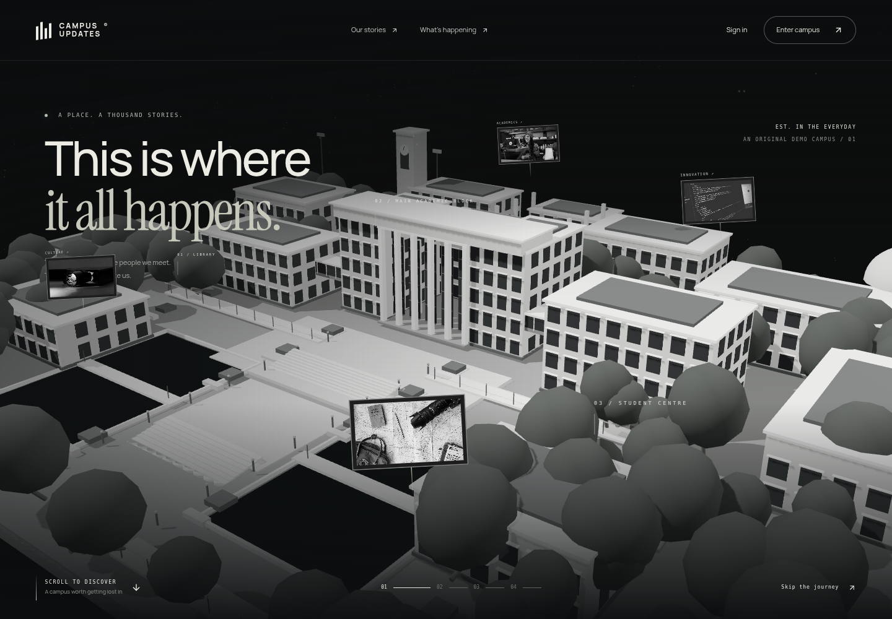
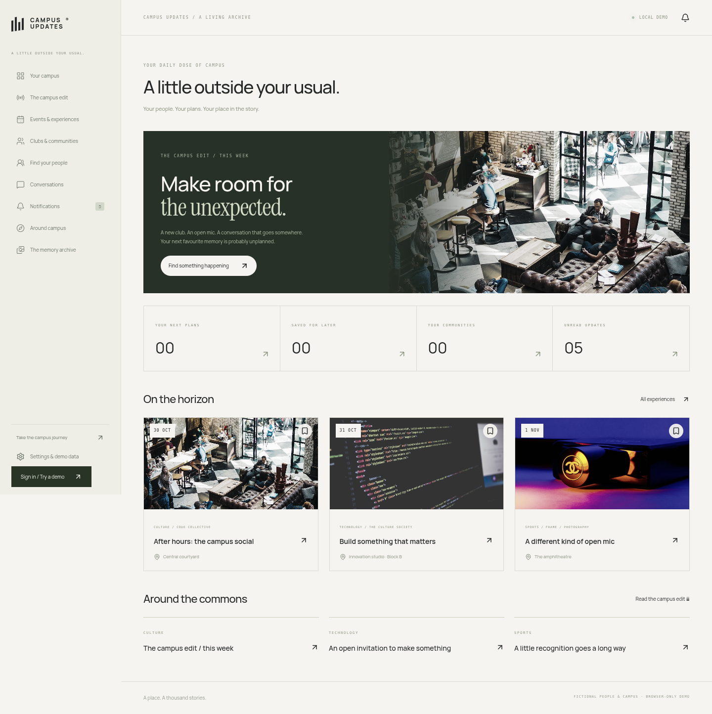

<div align="center">

# CAMPUS UPDATES

### A place. A thousand stories.

An immersive 3D campus journey, connected to the everyday life of a student community.

**Discover. Connect. Participate.**

[Take a look](#a-first-look) · [Run locally](#step-inside) · [Explore the features](#find-your-next-moment) · [Try the demo](#choose-your-perspective) · [Under the hood](#built-with)

`REACT` · `THREE.JS` · `GSAP` · `VITE` · `FRONTEND DEMO`



</div>

> The campus is more than a collection of buildings. It is a living archive of people, memories, opportunities, and experiences.

Campus Updates brings that idea to the browser: a monochrome architectural world, photographs suspended around its buildings, a scroll-controlled journey toward the entrance, and an editorial archive of student stories. Beyond the landing page is a campus platform for discovering events, joining communities, and finding people to build with.

---

## A first look

**Start with the place. Stay for the people.**

| The journey | What you can explore |
| --- | --- |
| **01 / The campus** | An original procedural 3D environment with academic buildings, colonnades, connecting walkways, a clock tower, trees, and water gardens. |
| **02 / The approach** | Scroll-controlled camera movement from the campus exterior toward the entrance and interior. Scroll backward to retrace the path. |
| **03 / The memories** | Floating photographs, architectural annotations, an editorial story sequence, and a tearable memory ticket. |
| **04 / The everyday** | Events, clubs, conversations, profiles, and local demo management tools in a shared application shell. |

<details>
<summary><strong>Open the application preview</strong></summary>

<br>



The application uses warm paper tones, restrained typography, muted borders, and photography to continue the landing page’s editorial identity.

</details>

<details>
<summary><strong>What makes the campus three-dimensional?</strong></summary>

<br>

The campus is constructed from geometry rendered with Three.js and React Three Fiber. It is not a background photograph enlarged on scroll. Buildings, columns, terraces, trees, and other repeated elements use instanced meshes, while the camera moves through the scene along a defined path.

The architecture is an original fictional design inspired by the project’s visual references. It is not an exact recreation of a real university.

</details>

## Step inside

### 1. Get the project

```bash
git clone https://github.com/thisissiddhimabhardwaj/FEE-PROJECT.git
cd FEE-PROJECT
```

You can also use **Code → Download ZIP** on the repository page and extract the folder.

### 2. Install and start

Use **Node.js 22.12+**; development was tested with **Node.js 24**.

```bash
npm ci
npm run dev
```

Open the local address printed by Vite in your terminal.

**No backend, database, API keys, or external authentication service is required.**

<details>
<summary><strong>Other useful commands</strong></summary>

<br>

| Command | Purpose |
| --- | --- |
| `npm ci` | Install the exact dependency versions in the lockfile. |
| `npm run dev` | Start the development server. |
| `npm run build` | Create the production bundle in `dist/`. |
| `npm run preview` | Serve the production bundle locally after building. |

```bash
npm run build
npm run preview
```

</details>

## Find your next moment

<details open>
<summary><strong>Explore / Events and communities</strong></summary>

<br>

- **Events:** search, category and date filters, grid and list views, monthly calendar, and individual event pages.
- **Registrations:** register, cancel, and save experiences using persistent local state.
- **Clubs:** discover communities, open club profiles, follow updates, and join or leave a demo club.
- **Campus edit:** browse posts, like updates, save content, and add local comments.
- **Around campus:** discover fictional study spaces, cafés, and gathering places through search and filters.

</details>

<details>
<summary><strong>Connect / People and conversations</strong></summary>

<br>

- **Profiles:** view fictional students, their interests and skills, and edit the current demo profile.
- **Teams:** discover students, filter by skill, create teams, and simulate invitation responses.
- **Messages:** send browser-local messages and receive clearly labelled simulated replies.
- **Notifications:** browse updates, filter unread items, and mark notifications as read.

Nothing in the messaging interface is sent to another person. It is a local demonstration.

</details>

<details>
<summary><strong>Remember / The campus archive</strong></summary>

<br>

- Browse a masonry-style collection of fictional memories.
- Search stories and filter by category.
- Open photographs in a dialog with previous and next navigation.
- Follow a memory back to its associated event.
- Try the landing page’s tearable ticket by clicking its stub or dragging across it.

</details>

<details>
<summary><strong>Organize / Role-specific workspaces</strong></summary>

<br>

**Admin demo:** manage local events, clubs, students, and announcements; inspect registration summaries.

**Club manager demo:** access a workspace scoped to Code Collective, with event and announcement editing, club profile tools, and membership and registration views.

These are frontend demonstrations. Role guards help demonstrate navigation and workflows; they do not provide production authorization or security.

</details>

## Choose your perspective

Open **Sign in** and select a role, then use **Try the … demo**. No real credentials are needed.

| Perspective | A good place to start |
| --- | --- |
| **Visitor** | Choose **Enter campus** to browse public experiences, clubs, stories, and locations. |
| **Student** | Try saving an event, registering, following a club, editing your profile, and sending a local message. |
| **Club manager** | Open the club workspace and create a demo event or announcement for Code Collective. |
| **Admin** | Open the admin workspace to explore local management tools. |

### A quick walkthrough

1. Scroll through the campus landing experience, or use **Enter campus** to go straight to the application.
2. Sign in with the **student demo**.
3. Open an event and select **Count me in**.
4. Follow a club, save another event, and visit your dashboard.
5. Refresh the page to see your browser-local state retained.
6. Try a different role from the sign-in page to explore its workspace.

> Want a fresh start? Open **Settings & demo data → Reset demo data**. This removes the preview’s local changes in the current browser.

## Built with

| Layer | Technology |
| --- | --- |
| Application | React, JavaScript / JSX, Vite |
| Navigation | React Router |
| 3D environment | Three.js, React Three Fiber, Drei |
| Cinematic motion | GSAP and ScrollTrigger |
| Styling | Custom CSS, Tailwind CSS tooling |
| Icons | Lucide React |
| Local persistence | Browser `localStorage` |

<details>
<summary><strong>Explore the source structure</strong></summary>

<br>

```text
FEE-PROJECT/
├── public/
│   ├── images/                 # Locally bundled illustrative photography
│   ├── InstrumentSerif.ttf
│   └── Manrope.ttf
├── src/
│   ├── cinematic/
│   │   ├── CampusScene.jsx     # Campus geometry, lighting, particles, camera
│   │   └── Landing.jsx         # Scroll journey and editorial storytelling
│   ├── components/
│   │   ├── Brand.jsx
│   │   ├── Shell.jsx           # Application navigation and layout
│   │   └── UI.jsx              # Shared cards, dialogs, and controls
│   ├── data/
│   │   └── demo.js             # Related fictional entities and initial state
│   ├── App.jsx                # Routes and demo role guards
│   ├── Management.jsx         # Local management workspaces
│   ├── pages.jsx              # Application page components
│   ├── store.jsx              # Shared state and localStorage persistence
│   ├── styles.css             # Design system and responsive layouts
│   └── main.jsx
├── preview-landing.png
├── preview-dashboard.png
├── package.json
└── vite.config.js
```

</details>

<details>
<summary><strong>What is in the demo data?</strong></summary>

<br>

The initial dataset includes **30 fictional students, 10 clubs, 35 events, 40 feed posts, 50 memories, 15 campus locations, 20 conversations, and 50 notifications**.

Events reference clubs, stories reference students and events, and conversations reference student profiles. Event dates are generated relative to the initial dataset creation so the starting experience includes upcoming plans.

Changes are stored under the preview’s own `localStorage` key. They are specific to the browser and site origin, are not shared across devices, and can disappear if browser storage is cleared. No real student information should be entered.

</details>

## Preview status

This repository contains a **first working preview**, with a successful production build and desktop Chromium captures of the landing experience and dashboard.

Full interaction, accessibility, and mobile-device validation is still unfinished. The campus currently uses stylized procedural geometry; it does not match the photorealistic detail of the supplied architectural references. Not every advanced animation reference has been implemented.

<details>
<summary><strong>Performance and practical notes</strong></summary>

<br>

- The 3D scene requires a WebGL-capable browser; the scene includes an error fallback with access to the application.
- The 3D route is loaded separately from the application pages. Its production bundle is still relatively large and triggers Vite’s chunk-size advisory.
- Reduced-motion styles and a simplified camera behavior are included. Further accessibility testing remains necessary.
- Photography and fonts are bundled locally; the preview does not need a live content API.
- For static hosting, configure an SPA fallback to `index.html` so direct links such as `/events/e0` resolve correctly.
- This preview is not suitable for real authentication, private conversations, or sensitive records without a backend and appropriate security work.

</details>

## Credits and assets

- **Type:** [Manrope](https://fonts.google.com/specimen/Manrope) and [Instrument Serif](https://fonts.google.com/specimen/Instrument+Serif), available under the SIL Open Font License.
- **Illustrative photography:** sample assets distributed with Start Bootstrap’s [Agency](https://github.com/StartBootstrap/startbootstrap-agency), [Landing Page](https://github.com/StartBootstrap/startbootstrap-landing-page), [Business Casual](https://github.com/StartBootstrap/startbootstrap-business-casual), and [Clean Blog](https://github.com/StartBootstrap/startbootstrap-clean-blog) templates. Consult upstream asset credits and terms before redistributing or publishing imagery.
- **Architecture:** an original procedural campus model created for this preview.
- **Interaction direction:** inspired by the supplied gallery, particle, topographic, and tactile-ticket references. Their usage examples informed the direction; this repository does not claim to include all of their original component implementations.

People, clubs, stories, and locations are fictional. Photographs are illustrative and are not verified images of a particular university. Replace them with approved campus photography for an institution-specific release.

---

<div align="center">

### The next story could be yours.

**CAMPUS UPDATES** · Discover. Connect. Participate.

[Back to the beginning ↑](#campus-updates)

</div>
